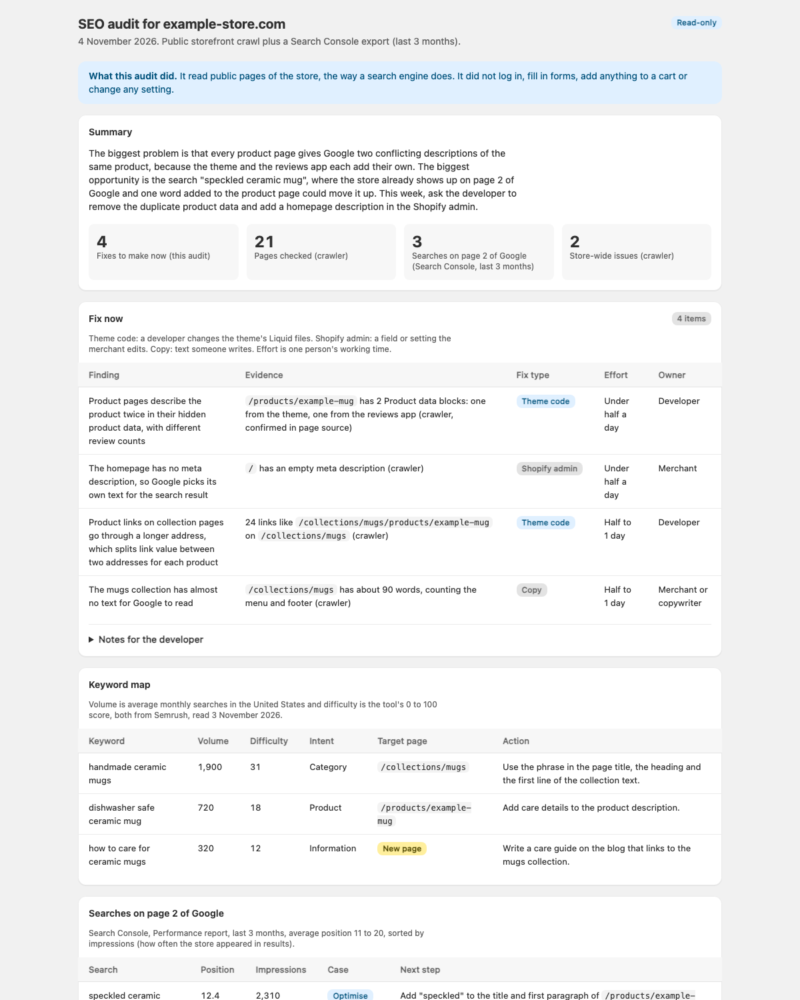

# shopify-seo-audit

A Claude skill that checks a Shopify store's SEO and writes a plain-English report the merchant can read. It crawls a sample of the store's public pages, reviews them against Shopify's own SEO audit framework, maps keywords to pages, and ranks every fix by who makes it: a developer in the theme, the merchant in the Shopify admin, or a copywriter.

**Who it's for:** agency project managers and Shopify merchants who need an SEO audit without being SEO specialists or developers.

**What it needs:** the store URL. A Google Search Console Performance export (Queries and Pages) and the Indexing → Pages report make it much better, but are optional. It runs in the Claude app with code execution on, or in Claude Code.

**What it never does:** it never logs in, never asks for passwords, never submits forms, never adds to cart or starts a checkout, and never changes the store. It only reads public pages, the way a search engine does.

## Install

### Claude app (no technical setup)

1. Download [shopify-seo-audit.zip](https://github.com/ShahzDevAventures/shopify-seo-audit/releases/latest/download/shopify-seo-audit.zip).
2. In Claude, open **Settings → Capabilities** and turn on **Code execution and file creation** (newer layouts call it **Create and edit files**).
3. Open **Customize → Skills**, click **+**, then **Create skill → Upload a skill**, and choose the file. Check that the skill is switched on.
4. Start a new chat.

On a Team or Enterprise plan, an owner first turns on code execution and Skills under **Organization settings → Plugins & skills → Policy**, and can add the skill for everyone in the organization.

The skill works best in Claude Code, because its crawler has to reach the store over the internet: in the Claude app, also turn on "Allow network egress" under Settings → Capabilities (on Team and Enterprise plans an owner allows the store's domain), or the skill falls back to a reduced audit and marks the checks it could not run as "Not checked".

### Claude Code

```bash
npx skills add ShahzDevAventures/shopify-seo-audit
```

Or clone it: `git clone https://github.com/ShahzDevAventures/shopify-seo-audit ~/.claude/skills/shopify-seo-audit`

The crawler needs Python 3.9 or later. It uses only the standard library.

## Use it

Say: "Run an SEO audit for example-store.com".

Claude asks only for what is missing: the store URL, a Search Console Performance export (Queries and Pages, last 3 or 12 months), and the Search Console Indexing → Pages report. Without a Search Console export it runs a storefront-only audit and says so at the top of the report. It works out the brand stage (new, growing or established) itself and takes three competitors from your brief or from Google's results.

For a theme rebuild, say: "Will the redesign hurt our SEO?" or "Run the post-launch SEO check".

Roughly how long it takes: the crawl takes 2 to 10 minutes, because it pauses between requests and slows down when the store rate-limits it. Reviewing the results and writing the report takes another 10 to 20 minutes.

## What you get

The report has these sections, in this order:

1. Summary: the biggest blocker, the biggest opportunity and what to do this week, in three sentences
2. Fix now: each finding with its evidence, fix type (theme code, Shopify admin or copy), effort and owner
3. Keyword map: each target keyword and the one page that should rank for it
4. Searches on page 2 of Google: queries at position 11 to 20, each marked optimise, maxed out or ignore
5. Findings by page type: homepage, collections, product pages, blog
6. Technical appendix: store-wide checks in plain words, with a link to the crawler output
7. Reports to request: the Search Console exports still missing

Files, all in `seo/`:

- `<store-handle>-shopify-seo-audit-<YYYY-MM-DD>.html`: the report for the merchant, styled like the Shopify admin. In the Claude app it also opens as an artifact.
- `seo-audit-<YYYY-MM-DD>.md`: the same report in Markdown, for the team and developer tickets.
- `seo-checks.md` and `seo-checks.json`: the crawler's raw results.
- For redesigns: `baseline-pages.csv`, `baseline-<date>.md` and `redirect-map.csv`.

## Sample report

This is a report for a made-up store, so you can see the output before you run it. [Open the full sample](https://shahzsiddiqui.vercel.app/skills/samples/shopify-seo-audit) in your browser. It is the same file as `references/report-template.html`.



The summary from that sample:

> The biggest problem is that every product page gives Google two conflicting descriptions of the same product, because the theme and the reviews app each add their own. The biggest opportunity is the search "speckled ceramic mug", where the store already shows up on page 2 of Google and one word added to the product page could move it up. This week, ask the developer to remove the duplicate product data and add a homepage description in the Shopify admin.
>
> 4 fixes to make now · 21 pages checked · 3 searches on page 2 of Google

## How it works

`scripts/seo_checks.py` reads `robots.txt` and the sitemap, samples a few URLs per type (home, products, collections, pages, blog posts) and checks each page for: HTTP status, title and meta description length, H1 count, canonical, `noindex`, the number of Product JSON-LD blocks, invalid JSON-LD, product links that go through `/collections/<x>/products/<y>`, images without alt text, and thin copy. At store level it checks for a missing sitemap, handles ending in `-N`, sitemap URLs blocked by `robots.txt`, the 404 page, and whether `/collections/all` is indexable. It waits 1.5 seconds between requests and backs off when the store answers HTTP 429.

Claude then confirms the findings on the live pages and works through the reference checklists: technical review, on-page rules by page type, keyword research and striking-distance triage, and, for redesigns, a before-and-after safeguard. The method follows Shopify Academy's "Search Engine Optimization with Shopify" course, extended with Shopify theme checks the course leaves out. It was codified from Shopify agency work at Sirge.

The crawler can also run on its own:

```bash
python3 -I scripts/seo_checks.py https://example-store.com seo --per-type 5
```

Limits:

- The crawl does not run JavaScript, so tags that apps add in the browser (review stars, some SEO apps) will not show. Claude checks findings against the page source or Search Console before reporting them.
- Speed and Core Web Vitals are not measured. Claude takes them from PageSpeed Insights or the Search Console Core Web Vitals report when you share them, and otherwise writes "Not checked".
- Word counts include the menu and footer, so they overstate body copy.
- Empty `alt` attributes count as missing alt text. Shopify themes print an empty `alt` when the merchant left the alt text blank, but a decorative image can be blank on purpose.
- The sample is the first N URLs per sitemap type, not a random sample.
- Keyword volume and difficulty come from a keyword tool you have access to; the skill only structures them.

## Files

- `SKILL.md`: the instructions Claude follows.
- `scripts/seo_checks.py`: the read-only crawler (Python standard library only).
- `references/checklist.md`: technical checks and on-page rules by page type.
- `references/keywords.md`: keyword baseline, SERP read, striking distance and the keyword map format.
- `references/redesign-safeguard.md`: what to record before a theme rebuild and what to check after launch.
- `references/report-template.html`: the HTML report template, filled with a made-up example.
- `LICENSE`: the MIT license.
- `docs/sample-report.png`: the screenshot in this README. It is not part of the skill and is left out of the zip.

## Author

Built by Shahz Siddiqui (https://github.com/ShahzDevAventures).

## License

MIT, see LICENSE.
